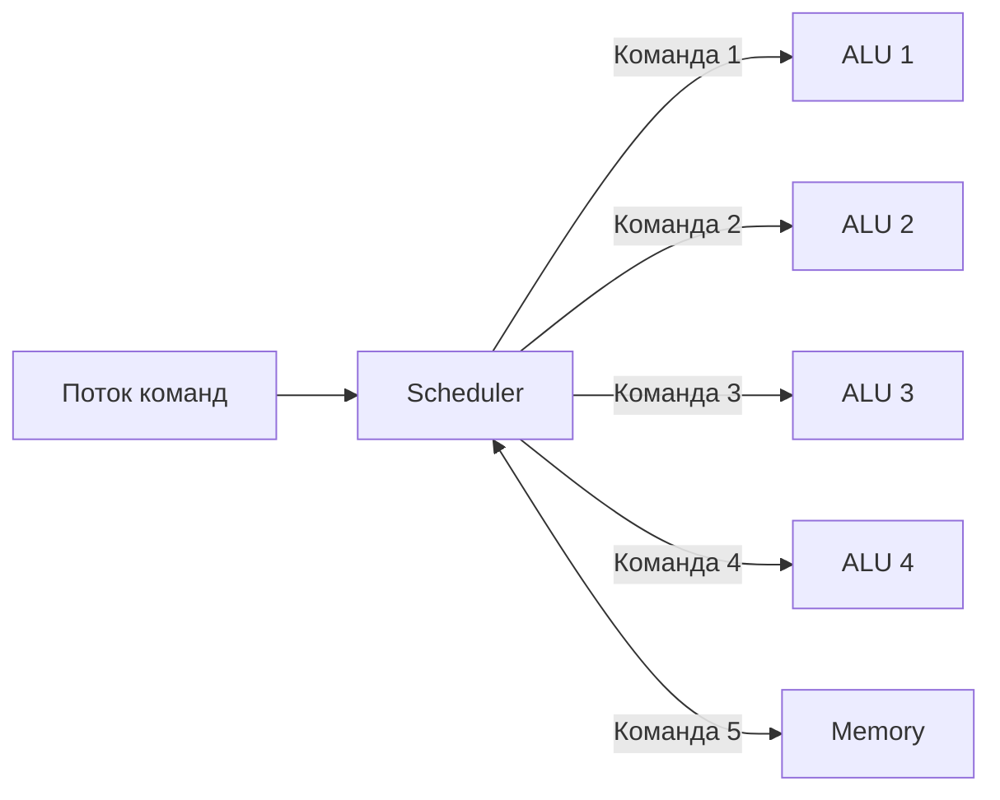

# Scheduler. Планировщик

## Описание

Необходимо реализовать синхронную схему-планировщик для одновременного выполнения нескольких комманд на языке Verilog.

Scheduler является центральным управляющим блоком системы, принимает команды, определяет возможность их выполнения и распределяет между доступными исполнительными блоками.

В системе предусмотрено 5 исполнительных блоков:

- 4 ALU - блоки, способные выполнять различные арифметические операции
- Memory - блок, ответственный за обращения к памяти

Каждый исполнительный блок может выполнять только одну команду в конкретный момент времени.

При исполнении команд планировщик должен учитывать доступность исполнительных блоков. Если свободного исполнительного блока нет, то планировщик должен отложить выполнение команды до выполнения необходимых требований.

Существующие команды:

0) `add` - сложить 2 числа
1) `sub` - вычесть из первого числа второе
2) `mul` - умножить 2 числа
3) `div` - разделить первое число на второе
4) `sll` - логический сдвиг влево
5) `slr` - логический сдвиг вправо
6) `sla` - арифметический сдвиг влево
7) `sra` - арифметический свдиг вправо
8) `rw` - прочитать 4 байта
9) `sw` - записать 4 байта

Код команды - порядковый номер в списке.

Все операции производятся над четырёхбайтными числами, формат - `little_endian`.
Все операции являются независимыми.

Несмотря на возможность параллельного выполнения команд, порядок предоставления результатов потребителю должен соответствовать порядку поступления исходных команд.

### ALU-блоки

Все 4 блока умеют выполнять все арифметические операции

### Memory-блок

Ответственен за обращения к памяти. Шина, по которой передаются данные между планировщиком и Memory-блоком - двунаправленная.

## Интерфейсы

У положенных в репозиторий модулей нельзя менять интерфейсы. Также внутри шедулера нельзя инстанцировать модули блоков. Все модули инстанцируются внутри test-bench-а и соединяются проводами. Это необходимо для авто-тестов.
